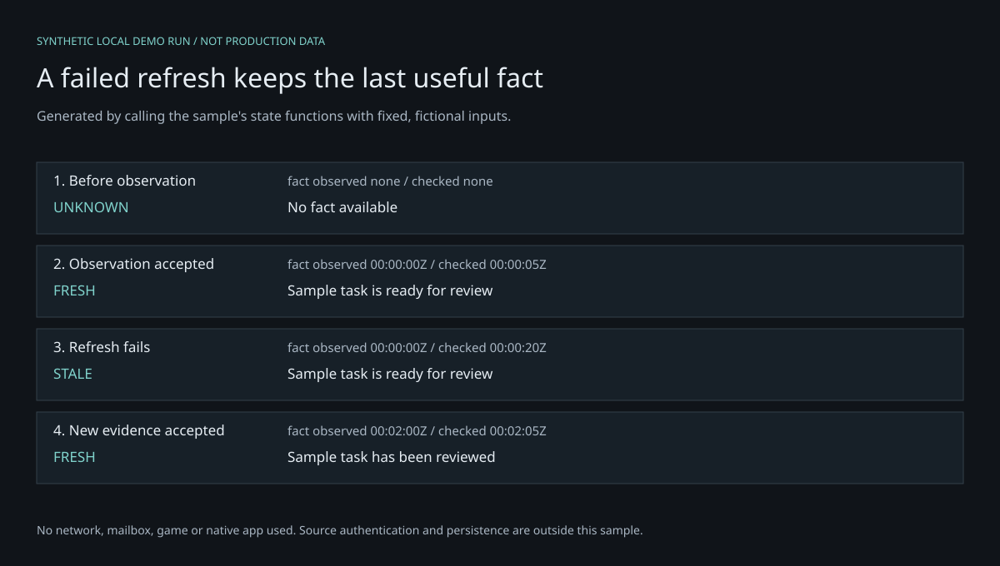

# Evidence-cache demo

A small, dependency-free JavaScript example of a product rule: **a failed refresh should preserve the last useful fact and show its original observation time.** It must not imply a new observation or current success.

Requires Node.js 22 or later. Nothing to install:

```sh
node demo.mjs
node --test cache.test.mjs
```

| Event | Retained evidence | Display status |
| --- | --- | --- |
| No observation / first failure | None | Unknown |
| Current successful observation | Value + source + observed time | Fresh until expiry |
| Refresh failure | Last good fact | Stale, with failed refresh |
| Older result / equal-time conflict | Last good fact | Stale, with reason |
| New successful observation | Updated fact | Fresh if within limit |

Expected run: unknown → fresh → stale after a failed refresh (same value, source and observation time) → fresh with a new fact. The script labels every value and timestamp synthetic. Tests should finish with 12 passed, 0 failed.



*Generated from this sample’s actual state functions using fixed fictional inputs; not a production log or PCC/MCP screenshot.*

The check time and the source observation time remain separate. Inputs are bounded. Error payloads are not retained. Tests cover expiry boundaries, out-of-order events, time zones, conflict, recovery and preservation through repeated failures.

This independent teaching example was prepared with Codex assistance on 14 October 2026. It accompanies a portfolio of products developed with Claude Code and Codex; this sample has its own recorded origin. It was written separately rather than extracted from PCC or MCP, and does not copy private project code, Git history, data, dependency implementations or game assets. It is inspired by general cache and provenance principles, and is not the production implementation of any featured project.

**Limits:** In-memory, one stream, no network, persistence, UI, concurrency control or source authentication. A caller must validate input and serialize refreshes; typed success events do not independently prove source truth. JavaScript Date parsing is not a full calendar-validation library. Do not treat this sample as a production cache or security boundary.

MIT license applies to the files in this standalone demo only. It does not apply to the separate portfolio, screenshots, third-party marks or private products.
